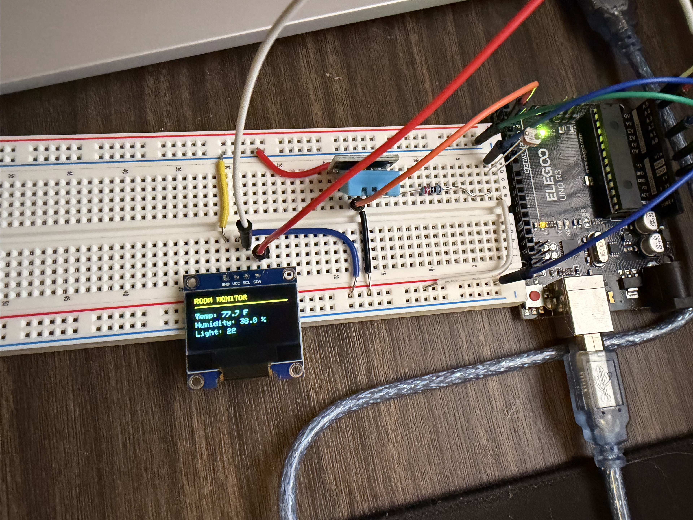
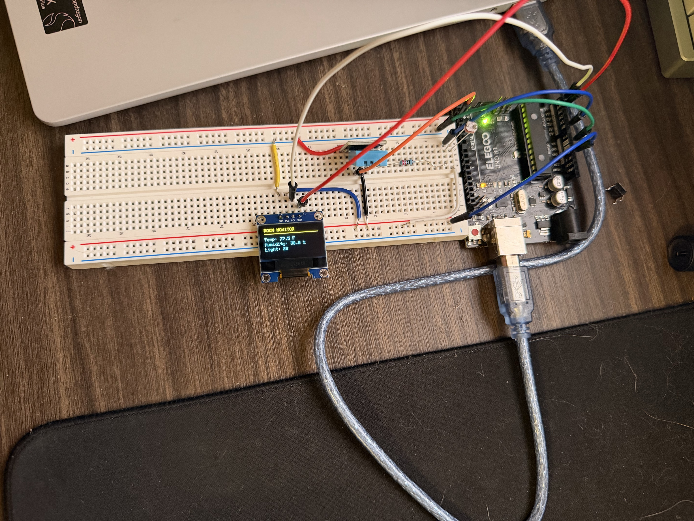

# Arduino Room Monitor

An Arduino UNO room monitor that displays temperature, humidity, and relative ambient light on a 128 x 64 OLED. Built by Jordan Tirado using C++ and breadboard-mounted components.



## Features

- Temperature in Fahrenheit and relative humidity from a DHT11 module.
- Raw ambient-light readings from a photoresistor voltage divider.
- SSD1306 OLED connected over I2C at address `0x3C`.
- Sensor sampling and display updates every two seconds, scheduled with `millis()` rather than `delay()`.
- Serial Monitor output at 9600 baud.
- DHT11 read-failure messages while light measurements continue to update.

## Demo video

*Demo video to be added.*

<!-- Edit this README on GitHub, remove the placeholder above, and drag your video into this section in the editor. Wait for the upload to finish, keep the generated attachment link, and commit the README. If GitHub rejects the file size or format, upload a shorter/compressed MP4 or replace the placeholder with a link to an externally hosted video. -->

## Hardware

| Component | Quantity |
| --- | --- |
| ELEGOO UNO R3 / Arduino UNO-compatible board | 1 |
| DHT11 three-pin temperature/humidity module | 1 |
| SSD1306 I2C OLED, 128 x 64, 0.96 inch | 1 |
| Photoresistor | 1 |
| 10 kOhm resistor | 1 |
| Breadboard | 1 |
| Jumper wires | As needed |
| USB cable | 1 |

Components came from an ELEGOO UNO Super Starter Kit, with a separate ELEGOO OLED module.

## Wiring

Disconnect USB before changing wiring. All modules share UNO ground. Match module pin functions rather than assuming every DHT11 board uses the same pin order.

| Connection | UNO pin / node |
| --- | --- |
| DHT11 signal | D2 |
| DHT11 VCC | 5V |
| DHT11 GND | GND |
| OLED SDA | A4 |
| OLED SCL | A5 |
| OLED VCC | 5V (for the 3.3-5V-rated module used here) |
| OLED GND | GND |
| Photoresistor first leg | 5V |
| Photoresistor second leg | A0 junction |
| 10 kOhm resistor first leg | A0 junction |
| 10 kOhm resistor second leg | GND |

```text
5V ---- photoresistor ----+---- A0
                         |
                     10 kOhm
                         |
                        GND
```

The A0 junction connects one photoresistor leg, one resistor leg, and the A0 jumper. Brighter light lowers the photoresistor resistance and raises the measured voltage with this wiring.



Additional hardware photos: [light sensor](docs/images/light-sensor.jpg) and [UNO connections](docs/images/uno-connections.jpg).

## Setup

1. Wire the components as listed above, then connect the UNO by USB.
2. Install these libraries through Arduino IDE Library Manager:
   - **DHT sensor library** by Adafruit
   - **Adafruit Unified Sensor**
   - **Adafruit SSD1306**
   - **Adafruit GFX Library**
   - Accept additional dependency installations when prompted.
3. Open `Room_Monitor/Room_Monitor.ino` in Arduino IDE.
4. Select **Arduino Uno** and the board's USB port.
5. Upload the sketch. The OLED briefly shows `Starting...`, then updates with sensor readings.
6. Optionally open Serial Monitor at **9600 baud**.

## How it works

The loop compares elapsed time against a 2000 ms interval using unsigned subtraction. When the interval expires, it reads the DHT11 and A0, converts temperature to Fahrenheit, draws the dashboard in the OLED's memory buffer, and sends the buffer to the display.

The light measurement uses the UNO's 10-bit ADC, producing values from 0 to 1023. It is a relative reading, not calibrated lux. Fixed display strings use `F()` to reduce SRAM use. The 128 x 64 monochrome display buffer occupies 1024 bytes of the UNO's 2048 bytes of SRAM.

The sketch does not use `delay()` to schedule updates; sensor reads and display transfers still take time. If a DHT11 reading is invalid, the dashboard shows an error and continues displaying light readings. An OLED initialization failure stops execution and reports an error over Serial; successful initialization does not prove that wiring or the I2C address is correct.

## Build observations

During manual checks, the light reading fell to approximately **0-2** when the photoresistor was covered and rose to approximately **232** under a phone flashlight. These values depend on lighting, sensor characteristics, and placement.

The completed build displayed temperature, humidity, and light readings on the OLED. These are functional observations, not a calibrated accuracy assessment or automated test results.

## Limitations

- DHT11 readings are suitable for general room trends; no reference-instrument calibration has been performed.
- Ambient light is reported as a raw ADC value, not lux.
- Data is not saved between updates or after power is disconnected.
- The display refreshes every two seconds; there are no historical graphs or alerts in this version.

## Possible next steps

- Record timestamped readings on a computer over Serial.
- Add minimum/maximum tracking or a recent-history graph.
- Add adjustable thresholds and status indicators.
- Compare readings against a reference thermometer and document results.
